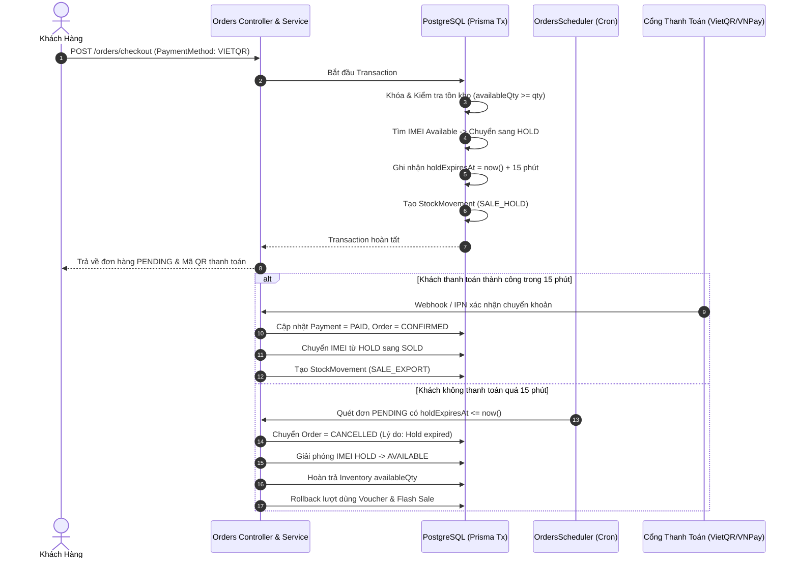
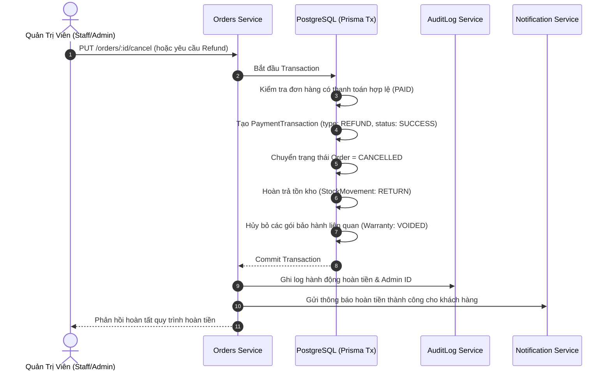
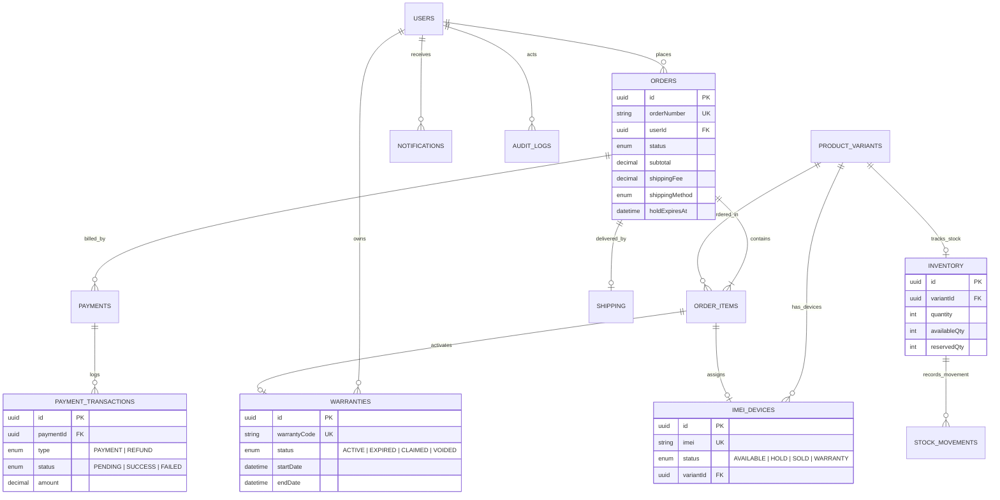

# 📱 PhoneShop — Nền Tảng Thương Mại Điện Tử Di Động & Phụ Kiện

<p align="center">
  
</p>

<p align="center">
  <strong>Hệ sinh thái E-Commerce toàn diện dành cho thiết bị di động chính hãng</strong><br>
  Xây dựng trên nền tảng <strong>NestJS 11 (Modular Monolith)</strong>, <strong>Prisma 7</strong>, <strong>PostgreSQL</strong> và <strong>React 19</strong>.<br>
  Được thiết kế với độ tin cậy cao, bảo đảm toàn vẹn dữ liệu hàng tồn kho, chống race condition và tích hợp quy trình vận hành thực tế.
</p>

<p align="center">
  <a href="https://phoneshop-blond.vercel.app" target="_blank"></a>
  <a href="https://phoneshop-api.onrender.com/api/docs" target="_blank"></a>
  
  
  
  
  
</p>

---

## 🌐 Đường Dẫn Trực Tiếp (Live Demo)

* **Trang web khách hàng & Quản trị**: [https://phoneshop-blond.vercel.app](https://phoneshop-blond.vercel.app)
* **Máy chủ Backend API**: [https://phoneshop-api.onrender.com/api](https://phoneshop-api.onrender.com/api)
* **Tài liệu đặc tả API tương tác (Swagger/OpenAPI)**: [https://phoneshop-api.onrender.com/api/docs](https://phoneshop-api.onrender.com/api/docs)

---

## 📑 Mục Lục
1. [Điểm Sáng Kiến Trúc & Kỹ Thuật Backend](#1-điểm-sáng-kiến-trúc--kỹ-thuật-backend)
2. [Sơ Đồ Luồng Dữ Liệu & Nghiệp Vụ (Mermaid)](#2-sơ-đồ-luồng-dữ-liệu--nghiệp-vụ-mermaid)
3. [Mô Hình Dữ Liệu Cốt Lõi (Core ERD)](#3-mô-hình-dữ-liệu-cốt-lõi-core-erd)
4. [Bảng Kết Quả Kiểm Thử Tự Động & Invariants](#4-bảng-kết-quả-kiểm-thử-tự-động--invariants)
5. [Đồng Bộ Contract & Chuẩn Hóa DTO Validation](#5-đồng-bộ-contract--chuẩn-hóa-dto-validation)
6. [Công Nghệ & Cấu Trúc Dự Án](#6-công-nghệ--cấu-trúc-dự-án)
7. [Hướng Dẫn Cài Đặt & Triển Khai (Docker & Local)](#7-hướng-dẫn-cài-đặt--triển-khai-docker--local)

---

## 1. Điểm Sáng Kiến Trúc & Kỹ Thuật Backend

Hệ thống PhoneShop giải quyết các thách thức kỹ thuật phức tạp thường gặp trong các nền tảng thương mại điện tử chuyên ngành thiết bị giá trị cao:

### 1.1. Quản Lý Hàng Tồn Kho & IMEI Với Interactive Transactions An Toàn
- **Mỗi thiết bị là duy nhất**: Theo dõi định danh vật lý của từng chiếc máy thông qua số IMEI duy nhất (`ImeiDevice` với trạng thái `AVAILABLE`, `HOLD`, `SOLD`, `WARRANTY`).
- **Atomic State Transitions**: Mọi bước đổi trạng thái kho hàng và gán máy đều nằm trong Prisma Interactive Transaction (`tx.$transaction`):
  - Khi đặt hàng: Tìm máy `AVAILABLE` -> chuyển sang `HOLD` -> trừ `availableQty` trong `Inventory` -> tạo `StockMovement` (loại `SALE_HOLD`).
  - Cam kết không có **Phantom Stock** (tồn kho ảo) và không thể bán trùng 1 IMEI cho 2 khách hàng đồng thời.

### 1.2. Giải Phóng Hold Tự Động Sau 15 Phút (`OrdersScheduler`)
- **Tự động quét định kỳ**: Background Cron Scheduler (`@Cron(CronExpression.EVERY_MINUTE)`) tìm các đơn hàng thanh toán trực tuyến (`VNPAY`, `VIETQR`) ở trạng thái `PENDING` có `holdExpiresAt <= now()`.
- **Phân biệt rành mạch với đơn COD**: Đơn nhận tiền mặt (COD) không bị giới hạn thời gian giữ chỗ (`holdExpiresAt = null`) và không bao giờ bị hủy tự động bởi scheduler.
- **Thu hồi idempotent**: Khi hủy đơn hết hạn, hệ thống hoàn kho `availableQty`, đưa IMEI về `AVAILABLE`, tạo `StockMovement` (loại `HOLD_EXPIRED`), hoàn trả số lượt dùng Voucher và rollback `soldCount` của Flash Sale.

### 1.3. Cơ Chế Chống Race Condition Khi Dùng Voucher & Flash Sale
- **Voucher Quota Protection**: Sử dụng câu lệnh cập nhật có điều kiện (`UPDATE vouchers SET used_count = used_count + 1 WHERE id = ... AND used_count < usage_limit`) kết hợp kiểm tra lịch sử sử dụng của từng khách hàng, ngăn chặn triệt để hành vi bypass hạn mức khi checkout đồng thời.
- **Rollback Flash Sale an toàn**: Tiện ích `rollbackFlashSoldCount` tự động hoàn lại số lượng đã bán của chiến dịch flash sale nếu đơn hàng bị hủy hoặc hoàn tiền trong thời gian chiến dịch còn hiệu lực.

### 1.4. Quy Trình Hoàn Tiền (Refund Workflow) An Toàn & Audit Log
- **Xác thực trạng thái nghiêm ngặt**: Chỉ cho phép hoàn tiền đối với các đơn hàng đã thanh toán thành công (`PaymentStatus.PAID` hoặc đơn đã chuyển sang `CANCELLED`/`DELIVERED`).
- **Ghi vết giao dịch tài chính**: Tạo bản ghi `PaymentTransaction` với loại `REFUND` và trạng thái `SUCCESS`.
- **Tự động kích hoạt chuỗi thu hồi**:
  - Hàng hóa chưa xuất giao được đưa trả về kho (`StockMovementType.RETURN`).
  - Mọi gói bảo hành đã kích hoạt cho đơn hàng sẽ chuyển sang trạng thái `VOIDED` (hủy bỏ).
  - Tự động ghi vết vào bảng `AuditLog` lưu lại danh tính Admin thực hiện, số tiền và lý do hoàn tiền.

### 1.5. Dynamic System Settings Với Fallback & TTL Cache
- **Cấu hình động không cần deploy**: Quản trị viên có thể bật/tắt chế độ bảo trì (`MAINTENANCE_MODE`) hoặc đóng/mở từng cổng thanh toán (`PAYMENT_COD_ENABLED`, `PAYMENT_VNPAY_ENABLED`, `PAYMENT_VIETQR_ENABLED`) ngay tại runtime.
- **Kiến trúc đọc 3 lớp (Fallback Order)**:
  1. `Database Setting`: Giá trị ghi đè động từ bảng `system_settings`.
  2. `Default Fallback`: Giá trị cấu hình mặc định an toàn.
  3. `Environment Variables`: Cấu hình môi trường nền tảng.
- **In-memory Caching**: Tích hợp bộ đệm TTL (Time-To-Live) giúp API phản hồi tức thì với độ trễ < 1ms mà không gây quá tải cho database.

---

## 2. Sơ Đồ Luồng Dữ Liệu & Nghiệp Vụ (Mermaid)

### 2.1. Luồng Đặt Hàng, Giữ Chỗ IMEI & Scheduler Quét Hết Hạn


### 2.2. Luồng Hoàn Tiền (Refund Order Workflow)


---

## 3. Mô Hình Dữ Liệu Cốt Lõi (Core ERD)



---

## 4. Bảng Kết Quả Kiểm Thử Tự Động & Invariants

Toàn bộ các luồng nghiệp vụ nhạy cảm của hệ thống được bảo vệ bằng các kịch bản kiểm thử tích hợp tự động với Jest:

| Tệp Kiểm Thử (Test Suite) | Invariants & Nghiệp Vụ Được Bảo Vệ | Kết Quả |
| :--- | :--- | :---: |
| `orders-release-reservation.spec.ts` | **Bảo vệ toàn vẹn kho hàng**: Giải phóng chính xác IMEI, hoàn trả `availableQty`, ghi vết `StockMovement` và hủy bảo hành khi hủy đơn hàng. | ✅ **PASS** |
| `orders-hold.spec.ts` | **Scheduler giữ chỗ & phân loại COD**: Đơn online được gán hold 15 phút và tự giải phóng khi hết hạn; đơn COD tuyệt đối không bị hủy tự động. | ✅ **PASS** |
| `payments-concurrency.spec.ts` | **Chống Double-Payment & Race Condition**: Idempotent IPN webhook xử lý an toàn kể cả khi nhận các gói tin callback trùng lặp từ cổng thanh toán. | ✅ **PASS** |
| `vouchers-limits.spec.ts` | **Giới hạn mã giảm giá**: Chặn vượt hạn mức sử dụng toàn hệ thống, giới hạn theo người dùng và bảo vệ công thức tính chiết khấu. | ✅ **PASS** |
| `staff-role-parity.spec.ts` | **Kiểm soát phân quyền RBAC**: Phân định ranh giới tác vụ giữa Quản trị viên (Admin), Quản lý (Manager), Nhân viên (Staff) và Khách hàng (User). | ✅ **PASS** |
| `auth-security.spec.ts` | **Bảo mật xác thực**: Luồng quên mật khẩu trả về phản hồi generic, bảo vệ danh tính khách hàng chống timing attack và email enumeration. | ✅ **PASS** |
| `system-settings-integration.spec.ts` | **Cấu hình động**: Chặn thanh toán hoặc đặt hàng tức thì khi quản trị viên kích hoạt bảo trì hoặc tắt cổng thanh toán tương ứng. | ✅ **PASS** |

---

## 5. Đồng Bộ Contract & Chuẩn Hóa DTO Validation

### 5.1. Cấu Hình Global Validation Chặt Chẽ
Tại `backend/src/main.ts`, hệ thống kích hoạt chế độ thẩm định đầu vào nghiêm ngặt:
```typescript
app.useGlobalPipes(
  new ValidationPipe({
    whitelist: true,              // Tự động loại bỏ các trường không khai báo trong DTO
    forbidNonWhitelisted: true,  // Báo lỗi 400 nếu client gửi trường lạ (chống Mass Assignment)
    transform: true,             // Tự động ép kiểu dữ liệu theo DTO
    transformOptions: { enableImplicitConversion: true },
  }),
);
```

### 5.2. Đồng Bộ Tra Cứu Bảo Hành Điện Tử
- Endpoint: `GET /api/warranty/search/:code` và `GET /api/warranty/lookup`
- Hỗ trợ đa dạng phương thức tra cứu: Mã bảo hành (`warrantyCode`), số **IMEI (15 số)**, số **Serial** và **Số điện thoại khách hàng**.
- Dữ liệu trả về chuẩn hóa gồm: Trạng thái kích hoạt, ngày kích hoạt, ngày hết hạn, số ngày còn lại và **thời hạn bảo hành chính hãng theo tháng** (`warrantyMonths`).

### 5.3. Đồng Bộ 4 Phương Thức Vận Chuyển & Biểu Phí
Biểu phí vận chuyển đồng nhất giữa Frontend và Backend (`ShippingService` & `constants.ts`):
- `ECONOMY` (Giao tiết kiệm): 20.000đ — *Miễn phí cho đơn hàng từ 500.000đ*.
- `STANDARD` (Giao tiêu chuẩn): 30.000đ — *Miễn phí cho đơn hàng từ 500.000đ*.
- `EXPRESS` (Giao nhanh 24h): 45.000đ — *Giảm 30.000đ (còn 15.000đ) cho đơn từ 500.000đ*.
- `EXPRESS_2H` (Hỏa tốc 2 giờ): 60.000đ — *Giảm 30.000đ (còn 30.000đ) cho đơn từ 500.000đ*.

---

## 6. Công Nghệ & Cấu Trúc Dự Án

### 6.1. Tech Stack
- **Backend Framework**: NestJS 11 (TypeScript, Modular Architecture).
- **Database & ORM**: PostgreSQL 16 + Prisma ORM 7.
- **Task Scheduling**: `@nestjs/schedule` (Cron background jobs).
- **Authentication**: Passport.js (JWT Access Token & Refresh Token), Google OAuth.
- **Security**: Helmet, Rate Limiting (`@nestjs/throttler`), CORS whitelist.
- **Testing**: Jest, Supertest.
- **Frontend**: React 19, Vite, Tailwind CSS, Zustand, Lucide Icons.

### 6.2. Cấu Trúc Thư Mục
```text
MobileCommerce/
├── backend/
│   ├── prisma/
│   │   ├── schema.prisma         # Định nghĩa Data Models & Enums
│   │   ├── migrations/           # Lịch sử Schema Migrations
│   │   └── seed.ts               # Dữ liệu mẫu (Catalog, Khách hàng, Đơn hàng)
│   ├── src/
│   │   ├── common/               # Filters, Guards, Interceptors, DTOs, Constants
│   │   ├── infrastructure/       # Storage (R2), Email (Brevo), Throttler
│   │   ├── modules/
│   │   │   ├── auth/             # Xác thực, JWT, RBAC
│   │   │   ├── cart/             # Giỏ hàng & DTO validation
│   │   │   ├── orders/           # Đặt hàng, Scheduler, Release hold, Refund
│   │   │   ├── payments/         # VietQR, VNPay IPN webhook
│   │   │   ├── inventory/        # Quản lý kho & Stock Movements
│   │   │   ├── imei/             # Quản lý vòng đời mã IMEI
│   │   │   ├── warranty/         # Tra cứu & kích hoạt bảo hành điện tử
│   │   │   ├── shipping/         # Tính phí & đồng bộ 4 phương thức giao hàng
│   │   │   ├── settings/         # Dynamic System Settings (Database > Env)
│   │   │   ├── audit-log/        # Ghi vết lịch sử thao tác quản trị
│   │   │   └── notifications/    # Thông báo in-app tự động
│   │   └── main.ts               # Khởi chạy ứng dụng & Global Pipes
│   └── test/                     # Automated Test Suites (Jest)
│
├── frontend/                     # Mã nguồn Giao diện Storefront & Admin (React 19)
├── docker-compose.yml            # Khởi chạy cụm môi trường Docker
└── README.md                     # Tài liệu kỹ thuật dự án
```

---

## 7. Hướng Dẫn Cài Đặt & Triển Khai (Docker & Local)

### 7.1. Chạy Nhanh Bằng Docker Compose
Chạy toàn bộ dịch vụ cơ sở dữ liệu PostgreSQL chỉ với một lệnh:
```bash
docker compose up -d
```

### 7.2. Cài Đặt & Khởi Chạy Backend

1. **Di chuyển vào thư mục backend và cài đặt dependencies**:
   ```bash
   cd backend
   npm install
   ```

2. **Cấu hình biến môi trường**:
   Sao chép tệp mẫu và cập nhật các thông số cần thiết:
   ```bash
   cp .env.example .env
   ```

3. **Sinh Prisma Client và đồng bộ Cơ sở dữ liệu**:
   ```bash
   npx prisma generate
   npx prisma db push
   npm run prisma:seed
   ```

4. **Chạy kiểm thử tự động (Automated Tests)**:
   ```bash
   npm test
   ```

5. **Biên dịch và khởi chạy máy chủ Development**:
   ```bash
   npm run build
   npm run start:dev
   ```
   * Cổng API khả dụng tại: `http://localhost:3000/api`
   * Tài liệu Swagger UI tại: `http://localhost:3000/api/docs`

### 7.3. Khởi Chạy Frontend
```bash
cd frontend
npm install
npm run dev
```
* Mở trình duyệt tại: `http://localhost:5173`

---

<p align="center">
  Phát triển với sự tâm huyết và kỷ luật kỹ thuật cao bởi <strong>PhoneShop Engineering Team</strong>.
</p>
